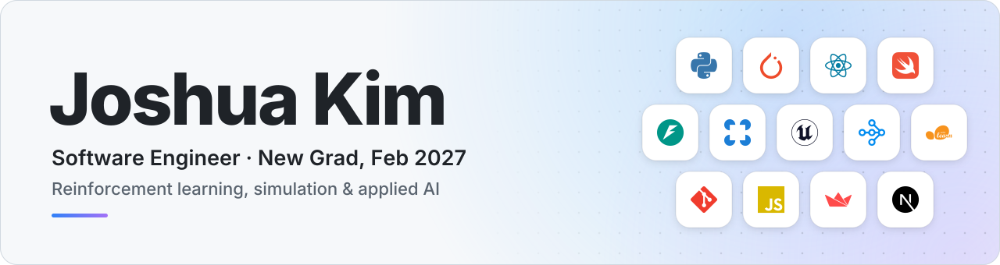
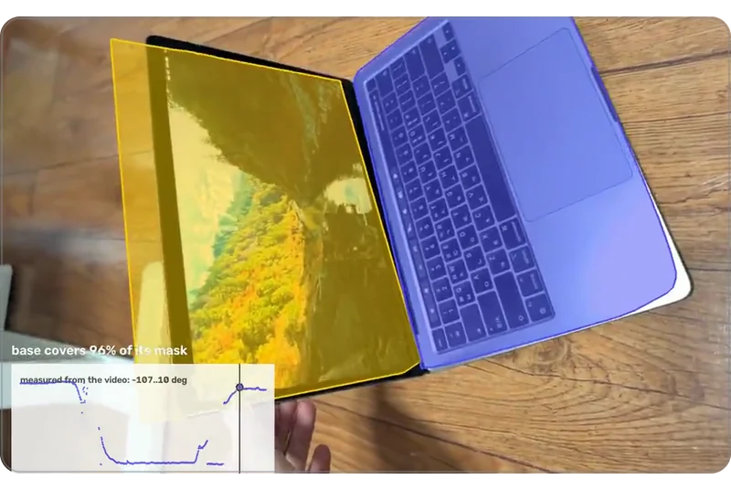
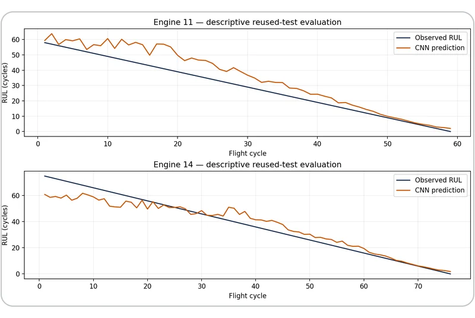
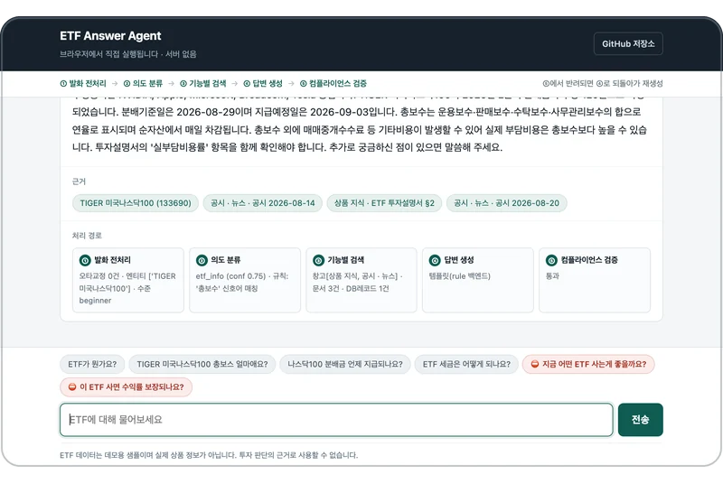
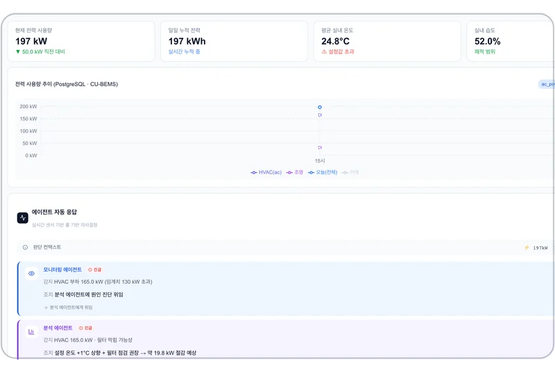
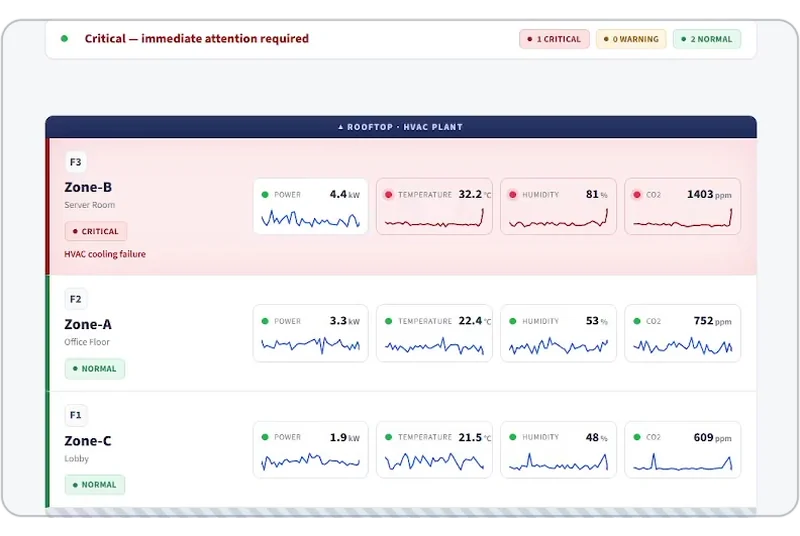

  <picture>
    <source media="(prefers-color-scheme: dark)" srcset="assets/banner-dark.svg">
    
  </picture>

  My projects span machine learning pipelines, AI agent workflows, and practical web applications. 
  I enjoy turning a problem into a working tool, then making its behavior and limitations easy to understand.

  <a href="https://www.linkedin.com/in/joshua-austin-kim"><picture><source media="(prefers-color-scheme: dark)" srcset="assets/buttons/linkedin-dark.svg"></picture></a>
  &nbsp;
  <a href="mailto:honeybeelawn@gmail.com"><picture><source media="(prefers-color-scheme: dark)" srcset="assets/buttons/email-dark.svg"></picture></a>

<table>
  <thead>
    <tr>
      <td align="left" valign="top">
         EDUCATION 
        <b>Korea University, Sejong Campus</b> 
        B.S. Computer Convergence Software
      </td>
      <td align="left" valign="top">
         GRADUATING 
        <b>February 2027</b>
      </td>
    </tr>
  </thead>
  <tbody>
    <tr>
      <td align="left" valign="top">
         LOOKING FOR 
        <b>Software engineering and applied AI roles</b> 
        New grad · United States
      </td>
      <td align="left" valign="top">
         WORK AUTHORIZATION 
        <b>U.S. citizen</b>
      </td>
    </tr>
  </tbody>
</table>

##  Awards

<table>
  <tr>
    <td width="50%" valign="top">
       
      <b>5th Place, Indie Developer Track ($25,000)</b> 
      <a href="https://cerebralvalley.ai/e/meta-ai-developer-hackathon/hackathon/gallery/2050">Meta Global AI Developer Hackathon</a>, November 2026; 5,367 projects were submitted. 
      Project: <a href="https://github.com/SungHyunC/video2urdf">Video2URDF</a>, built solo.
    </td>
    <td width="50%" valign="top">
       
      <b>Excellence Award</b> 
      Industry-Linked Capstone Design Competition, Korea University Sejong Campus, spring 2026. 
      Project: <a href="https://github.com/SungHyunC/multi-agent-bems">Multi-Agent BEMS</a>, a capstone design project.
    </td>
  </tr>
</table>

##  Selected projects

<table>
  <tr>
    <td width="40%">
      
    </td>
    <td>
      <h3><a href="https://github.com/SungHyunC/video2urdf">Video2URDF</a></h3>
      
<b>5th Place, Indie Developer Track, Meta Global AI Developer Hackathon.</b> A Muse Spark agent turns one phone or iPhone LiDAR video of an articulated object into a measured URDF/MJCF using SAM 3.1 part tracking and least-squares joint fitting, then checks it by replaying the model in MuJoCo over the video.

      

        <picture><source media="(prefers-color-scheme: dark)" srcset="assets/chips/python-dark.svg"></picture>
        <picture><source media="(prefers-color-scheme: dark)" srcset="assets/chips/sam-3-1-dark.svg"></picture>
        <picture><source media="(prefers-color-scheme: dark)" srcset="assets/chips/muse-spark-dark.svg"></picture>
        <picture><source media="(prefers-color-scheme: dark)" srcset="assets/chips/mujoco-dark.svg"></picture>
      

      
<a href="https://github.com/SungHyunC/video2urdf">Repository</a> · <a href="https://sunghyunc.github.io/video2urdf/">Live demo</a> · <a href="https://youtu.be/aK_csSIU24c">Demo video</a>

    </td>
  </tr>
</table>

<table>
  <tr>
    <td width="40%">
      
    </td>
    <td>
      <h3><a href="https://github.com/SungHyunC/engine-rul-prediction">Engine RUL Prediction</a></h3>
      
Parallel HDF5 processing and CNN experiments on NASA N-CMAPSS simulated engine data, with recorded results and evaluation caveats.

      

        <picture><source media="(prefers-color-scheme: dark)" srcset="assets/chips/python-dark.svg"></picture>
        <picture><source media="(prefers-color-scheme: dark)" srcset="assets/chips/pytorch-dark.svg"></picture>
        <picture><source media="(prefers-color-scheme: dark)" srcset="assets/chips/hdf5-dark.svg"></picture>
      

      
<a href="https://github.com/SungHyunC/engine-rul-prediction">Repository</a> · <a href="https://github.com/SungHyunC/engine-rul-prediction/blob/HEAD/output/report_en.pdf">Report (PDF)</a>

    </td>
  </tr>
</table>

<table>
  <tr>
    <td width="40%">
      
    </td>
    <td>
      <h3><a href="https://github.com/SungHyunC/etf-answer-agent">ETF Answer Agent</a></h3>
      
A prototype question-answering workflow with retrieval, validation gates, and revision routing.

      

        <picture><source media="(prefers-color-scheme: dark)" srcset="assets/chips/python-dark.svg"></picture>
        <picture><source media="(prefers-color-scheme: dark)" srcset="assets/chips/langgraph-dark.svg"></picture>
      

      
<a href="https://github.com/SungHyunC/etf-answer-agent">Repository</a> · <a href="https://sunghyunc.github.io/etf-answer-agent/">Live demo</a>

    </td>
  </tr>
</table>

<table>
  <tr>
    <td width="40%">
      
    </td>
    <td>
      <h3><a href="https://github.com/SungHyunC/multi-agent-bems">Multi-Agent BEMS</a></h3>
      
Capstone project (Excellence Award): a LangGraph supervisor routes operator questions to monitoring, analysis and report agents over simulated building-energy data, with rule-based alerts and fallbacks.

      

        <picture><source media="(prefers-color-scheme: dark)" srcset="assets/chips/python-dark.svg"></picture>
        <picture><source media="(prefers-color-scheme: dark)" srcset="assets/chips/langgraph-dark.svg"></picture>
        <picture><source media="(prefers-color-scheme: dark)" srcset="assets/chips/fastapi-dark.svg"></picture>
        <picture><source media="(prefers-color-scheme: dark)" srcset="assets/chips/nextjs-dark.svg"></picture>
      

      
<a href="https://github.com/SungHyunC/multi-agent-bems">Repository</a>

    </td>
  </tr>
</table>

<table>
  <tr>
    <td width="40%">
      
    </td>
    <td>
      <h3><a href="https://github.com/SungHyunC/BEMS-Anomaly-Operations-Center">BEMS Anomaly Operations Center</a></h3>
      
Building-energy sensor data recovery, rule-based diagnostics, and an operations dashboard.

      

        <picture><source media="(prefers-color-scheme: dark)" srcset="assets/chips/python-dark.svg"></picture>
        <picture><source media="(prefers-color-scheme: dark)" srcset="assets/chips/fastapi-dark.svg"></picture>
        <picture><source media="(prefers-color-scheme: dark)" srcset="assets/chips/streamlit-dark.svg"></picture>
      

      
<a href="https://github.com/SungHyunC/BEMS-Anomaly-Operations-Center">Repository</a> · <a href="https://youtu.be/Qljy0q05-nU">Video walkthrough</a>

    </td>
  </tr>
</table>

##  Team contributions

- **[MOA — AI-powered civic reporting](https://github.com/nxtcloud-edu/2026-07-kosj-industry-practice-team04):** Contributed AI classification, the React admin console, and report grouping and prioritization in a university industry-practice team project. See the merged [classifier](https://github.com/nxtcloud-edu/2026-07-kosj-industry-practice-team04/pull/28) and [admin console](https://github.com/nxtcloud-edu/2026-07-kosj-industry-practice-team04/pull/29) pull requests. The linked deployment currently demonstrates the frontend; the backend runs locally.
- **[BidderBidder iOS](https://github.com/FakeDevelopers/BidderBidder_IOS):** Contributed login/signup flows, [Firebase phone verification](https://github.com/FakeDevelopers/BidderBidder_IOS/pull/10), [search UI](https://github.com/FakeDevelopers/BidderBidder_IOS/pull/21), and [SwiftLint CI](https://github.com/FakeDevelopers/BidderBidder_IOS/pull/15) through merged pull requests for a used-goods auction app.

##  Tools used in these projects

  <picture><source media="(prefers-color-scheme: dark)" srcset="assets/chips/python-dark.svg"></picture>
  <picture><source media="(prefers-color-scheme: dark)" srcset="assets/chips/javascript-dark.svg"></picture>
  <picture><source media="(prefers-color-scheme: dark)" srcset="assets/chips/swift-dark.svg"></picture>
  <picture><source media="(prefers-color-scheme: dark)" srcset="assets/chips/sql-dark.svg"></picture>

  <picture><source media="(prefers-color-scheme: dark)" srcset="assets/chips/pytorch-dark.svg"></picture>
  <picture><source media="(prefers-color-scheme: dark)" srcset="assets/chips/scikit-learn-dark.svg"></picture>
  <picture><source media="(prefers-color-scheme: dark)" srcset="assets/chips/mujoco-dark.svg"></picture>
  <picture><source media="(prefers-color-scheme: dark)" srcset="assets/chips/langgraph-dark.svg"></picture>
  <picture><source media="(prefers-color-scheme: dark)" srcset="assets/chips/fastapi-dark.svg"></picture>
  <picture><source media="(prefers-color-scheme: dark)" srcset="assets/chips/streamlit-dark.svg"></picture>
  <picture><source media="(prefers-color-scheme: dark)" srcset="assets/chips/react-dark.svg"></picture>
  <picture><source media="(prefers-color-scheme: dark)" srcset="assets/chips/nextjs-dark.svg"></picture>
  <picture><source media="(prefers-color-scheme: dark)" srcset="assets/chips/git-dark.svg"></picture>

For implementation details, setup instructions, and experiment evidence, start with the linked project READMEs.
