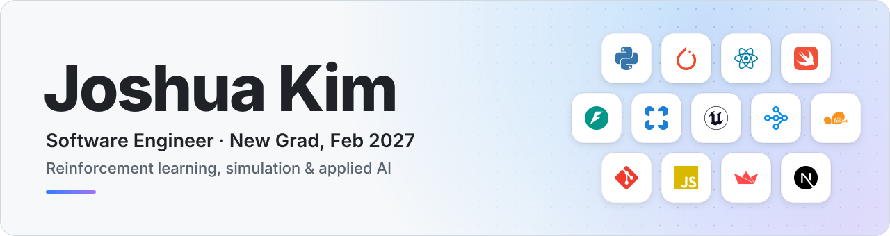

  <picture>
    <source media="(prefers-color-scheme: dark)" srcset="assets/banner-dark.svg">
    
  </picture>

  <a href="https://sunghyunc.github.io/"><picture><source media="(prefers-color-scheme: dark)" srcset="assets/buttons/portfolio-dark.svg"></picture></a>
  &nbsp;
  <a href="https://www.linkedin.com/in/joshua-austin-kim"><picture><source media="(prefers-color-scheme: dark)" srcset="assets/buttons/linkedin-dark.svg"></picture></a>
  &nbsp;
  <a href="mailto:honeybeelawn@gmail.com"><picture><source media="(prefers-color-scheme: dark)" srcset="assets/buttons/email-dark.svg"></picture></a>

  I build AI that learns in simulation, and tools that make its behavior easy to check. 
  Available from January 2027 · U.S. citizen · Korea University, B.S. Computer Convergence Software (Feb 2027)

### Highlights

- **5th Place ($25,000), [Meta Global AI Developer Hackathon](https://cerebralvalley.ai/e/meta-ai-developer-hackathon/hackathon/gallery/2050)**: a finalist in the Indie Developer Track among about 20,000 participants, with Video2URDF, built solo.
- **Top Award, KU AI Startup Idea Challenge 2026**: team lead for ROADMINE, which turns dashcam video into anonymized, signed data on rare driving events.
- **Undergraduate researcher, [IDS Lab](https://ids-ku.github.io/), Korea University**: multi-agent reinforcement learning for air combat.

### Featured projects

- **[Video2URDF](https://github.com/SungHyunC/video2urdf)**: one phone video of an articulated object in, a measured URDF/MJCF robot model out, checked by replaying it in MuJoCo over the video. [Live demo](https://sunghyunc.github.io/video2urdf/)
- **Air-combat AI**: a PPO F-16 dogfighting agent whose arbitration layer raised its head-on score from 0.39 to 0.88, and a JAX port of JSBSim that trains 7–10× faster for reproducing an IEEE ICA 2025 multi-agent RL paper.
- **[MA-BEMS](https://github.com/SungHyunC/ma-bems-project)**: six agents run a simulated campus beside a rule-based BMS and cut energy cost by 16.7% in simulation. [Live dashboard](https://sunghyunc.github.io/ma-bems/)

  <picture><source media="(prefers-color-scheme: dark)" srcset="assets/chips/python-dark.svg"></picture>
  <picture><source media="(prefers-color-scheme: dark)" srcset="assets/chips/pytorch-dark.svg"></picture>
  <picture><source media="(prefers-color-scheme: dark)" srcset="assets/chips/jax-dark.svg"></picture>
  <picture><source media="(prefers-color-scheme: dark)" srcset="assets/chips/ray-rllib-dark.svg"></picture>
  <picture><source media="(prefers-color-scheme: dark)" srcset="assets/chips/mujoco-dark.svg"></picture>
  <picture><source media="(prefers-color-scheme: dark)" srcset="assets/chips/jsbsim-dark.svg"></picture>
  <picture><source media="(prefers-color-scheme: dark)" srcset="assets/chips/isaac-gym-dark.svg"></picture>
  <picture><source media="(prefers-color-scheme: dark)" srcset="assets/chips/langgraph-dark.svg"></picture>
  <picture><source media="(prefers-color-scheme: dark)" srcset="assets/chips/react-dark.svg"></picture>

**All projects, research and awards: [sunghyunc.github.io](https://sunghyunc.github.io/)**
